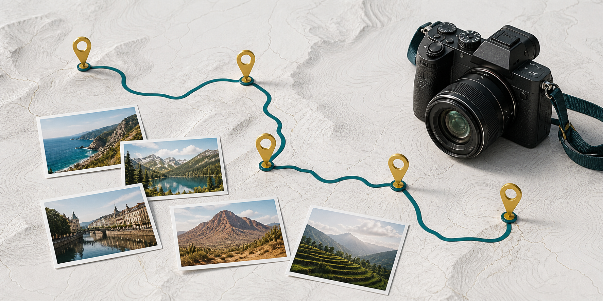
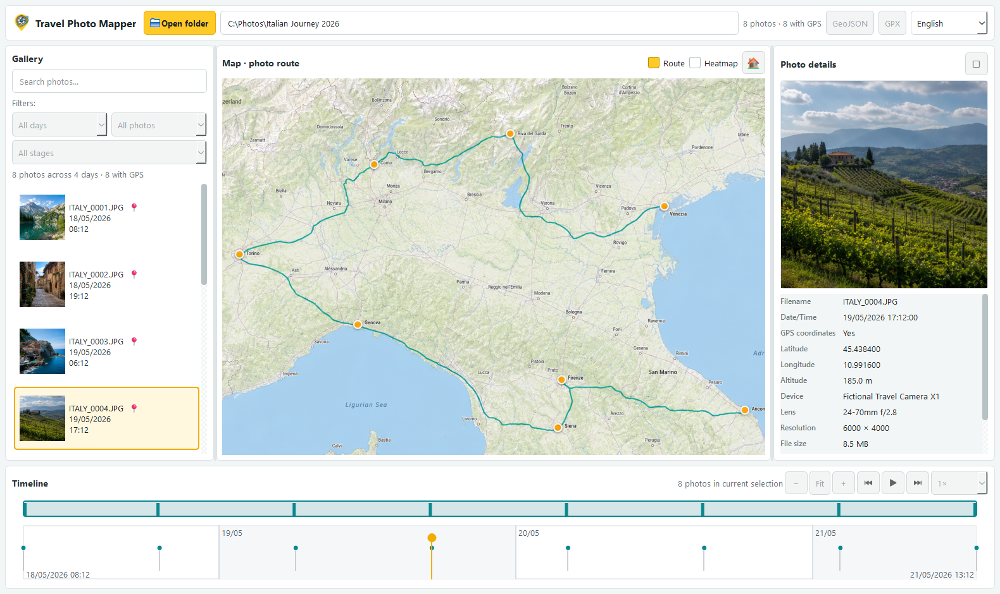

# Travel Photo Mapper

<p align="center">
  
</p>

**Travel Photo Mapper** is a desktop application for exploring travel
photos by place and time. Point it at a folder and it builds an interactive
map, gallery, timeline, and metadata catalog without modifying the originals.



## Highlights

- Recursively scans folders containing JPEG, PNG, TIFF, HEIC, and HEIF images.
- Reads EXIF capture time, GPS coordinates, altitude, camera, lens, and image
  dimensions.
- Connects the gallery and map in both directions: selecting a photo highlights
  its marker, while selecting a marker opens the corresponding photo.
- Groups dense locations with marker clustering and provides route and heatmap
  overlays.
- Offers an interactive timeline with zoom, panning, density overview, date
  source indicators, and adjustable chronological playback.
- Filters by date, estimated trip stage, filename, and GPS availability.
- Opens originals in a window or full screen with zoom, 1:1 view, fit-to-window,
  panning, and previous/next navigation.
- Exports the current filtered selection to GeoJSON or GPX.
- Saves named trips with filters, selected photo, timeline view, and playback speed.
- Exports portable HTML albums with optimized photos, an offline gallery, and an
  optional online map.
- Checks GitHub at startup and shows a toast when a newer stable release is available.
- Provides Italian and English interfaces, with automatic system-language
  detection and a persistent preference.



## How It Works

1. Open a folder containing travel photos.
2. Travel Photo Mapper scans its subfolders in a background thread.
3. EXIF metadata and thumbnails are cached locally for faster subsequent scans.
4. Use the gallery, map, timeline, search field, and filters to explore the trip.
5. Open any selected photo in the built-in viewer or in its default application.
6. Export the visible selection when you need portable geographic data.

The yellow route is a chronological connection between geotagged photos. It is
not a recorded GPS track and should not be interpreted as the exact path taken.

## Saved Trips (1.1.0)

Open a photo folder, then choose **Trips > Save trip** and give it a name.
The trip remembers its source folder, search, day/stage/GPS filters, route and
heatmap visibility, selected photo, timeline zoom and position, and playback speed.
The session updates automatically when switching folders or closing the app.

Choose **Trips > Saved trips** to reopen, rename, or remove a saved trip. Reopening
rescans the folder using the existing cache, so added or removed photos are
reflected. Selection is stored by relative file path rather than gallery index.
If the source folder has moved, the app lets you select its new location.
Removing a saved trip leaves the original photos and caches intact.

## Shareable HTML Albums (1.1.0)

1. Set the desired filters in the gallery.
2. Click **HTML album**, enter a title, and choose a destination folder.
3. Choose whether to include GPS coordinates and a map, then export.
4. Share the entire generated `album-...` subfolder, or zip it for transfer.
5. The recipient opens `index.html` directly in a modern browser; no app or server
   is required.

The album includes every filtered photo, including those without GPS. It contains
responsive thumbnails and a photo viewer with previous/next buttons, arrow-key
navigation, and Escape to close. The gallery works offline. **Load the map** opts
into downloading Leaflet, MapLibre and OpenFreeMap vector maps based on
OpenStreetMap data; map markers open their photos. The map requires a browser
with WebGL support and works when opening `index.html` directly as a local file.
The route connects photo locations chronologically and is not an actual GPS track.

Exported images are oriented JPEG copies with a maximum edge of 1920 pixels;
thumbnails fit within 480 by 360 pixels. EXIF metadata and original filesystem
paths are omitted. Filenames and capture dates remain visible. Disabling GPS
omits coordinates from the album data and hides the map. Original photos are
never modified. New exports use a fresh numbered folder when needed, and a
cancelled or failed export leaves no partial album.

Local albums use [OpenFreeMap](https://openfreemap.org/quick_start/) rather than
the standard OSM tile server: the [OSM tile usage policy](https://operations.osmfoundation.org/policies/tiles/)
requires a web Referer, which local `file://` pages cannot provide. Map
attribution remains visible. If you exported an album with an earlier version,
export it again to include the corrected map loader.

## Quick Start

### Windows

```bat
run_windows.bat
```

The script creates `.venv`, installs the runtime dependencies when necessary,
and launches the application.

### macOS and Linux

```bash
chmod +x run_macos_linux.sh
./run_macos_linux.sh
```

### Manual Setup

```bash
python -m venv .venv
```

Activate the environment for your shell, then run:

```bash
python -m pip install --upgrade pip
python -m pip install -e .
python -m travel_photo_mapper
```

The editable installation makes the package in `src/` available to the
application and tests. Source changes take effect without reinstalling. You can
also launch the installed application with `travel-photo-mapper`.

## Download Windows Setup

The Windows setup is available in the Github release tag.

## Check for Updates

At each startup, the app checks for updates in the background. It queries the
public `GiancaGIS/TravelPhotoMapper` repository using GitHub's
official [latest release REST endpoint](https://docs.github.com/en/rest/releases/releases#get-the-latest-release):

```text
GET https://api.github.com/repos/GiancaGIS/TravelPhotoMapper/releases/latest
```

The check runs asynchronously and compares the published release tag with the
installed app version. Tags use Semantic Versioning, for example `1.2.0` or
`v1.2.0`; `1.10.0` compares newer than `1.9.0`. Only published stable releases
are considered. Git tags without an associated GitHub release are excluded.
An installed development version newer than the published release is kept.

When an update is available, a nonmodal toast appears in the bottom-right corner
with both versions and **Open release on GitHub**, where you can read the release
notes and download the setup. You can close the toast; it also dismisses after
15 seconds, allowing extra time while hovered or focused. The notification
appears again at the next startup while a newer version remains available.
Up-to-date results and connection failures are silent.
The check requires no GitHub account or token. Requests use the API version
`2026-03-10`, a 12-second transfer timeout, and ETag conditional requests for
repeated checks during the same session. GitHub rate limits suspend further
requests according to its retry headers.


## Build the Windows Installer

The Windows release pipeline uses PyInstaller for the standalone executable and
Inno Setup 6 for the installer.

Prerequisites:

- a working project environment created by `run_windows.bat`;
- [Inno Setup 6](https://jrsoftware.org/isinfo.php).

Build the executable and installer:

```bat
build_windows.bat
```

Outputs:

```text
dist\TravelPhotoMapper.exe
dist\installer\TravelPhotoMapper-Setup-1.1.0.exe
```

The setup wizard supports two installation modes:

- **Current user:** installs under the user's local Programs directory in
  `AppData` and does not require administrator privileges.
- **All users:** installs under `Program Files` and requests elevation through
  Windows UAC.

For unattended deployments, select the mode with `/CURRENTUSER` or `/ALLUSERS`.

Build only the standalone executable:

```bat
build_windows.bat -SkipInstaller
```

Reuse already-installed build dependencies:

```bat
build_windows.bat -SkipDependencies
```

Both switches can be combined.

## Local Data and Privacy

Travel Photo Mapper never writes metadata into the original photos. The SQLite
catalog and generated thumbnails are stored in the per-user application data
directory returned by Qt's `QStandardPaths.AppDataLocation`.

Cached entries are validated using the file path, size, and modification time,
so unchanged photos do not need to be analyzed again.

Named trip sessions are stored separately in `saved_trips.sqlite` in the same
application data directory. They reference the source photos rather than copying
them; the source folder must remain available to reopen a trip.

## Network Access

The map view loads Leaflet, the marker-clustering and heatmap plugins, and
OpenStreetMap tiles over the internet. Photo scanning, metadata extraction,
thumbnail generation, caching, filtering, and the photo viewer operate locally.
Exported HTML albums only access the network after the recipient clicks
**Load the map**; the photo gallery and viewer remain local.
Album maps load their libraries from `unpkg.com` and their basemap from
`tiles.openfreemap.org`. Loading errors restore the map button so you can retry.
The update checker contacts `api.github.com` once at each application startup.
It sends the app name and version in its User-Agent header. Photo files, paths,
and saved trips stay on the computer. The result can open the release page on
`github.com` in your browser when you click the toast's release button.

## Project Structure

```text
src/travel_photo_mapper/ Application package
  __main__.py            Module entry point (python -m travel_photo_mapper)
  main.py                Qt application startup
  app_info.py            Product name and version
  i18n.py                Italian and English translations
  models/                Photo data model
  services/              Scanning, EXIF, cache, thumbnails, trips, and exports
  ui/                    Windows, map, timeline, and photo viewer
  assets/                Application icons bundled with the package
pyproject.toml           Package metadata, dependencies, and launcher
images/                  README artwork
packaging/               PyInstaller specification and Windows metadata
installer/               Inno Setup project
tests/                   Unit and UI logic tests
```

## Tests

After the editable installation described above, run from the project root:

```bash
python -m unittest discover -s tests -v
```

The test suite covers translations, EXIF parsing, persistent caching, trip-stage
generation, filtered exports, map interactions, timeline behavior, original
image loading, and scan cancellation.
It also covers saved-trip persistence and restoration, HTML album portability,
metadata removal, GPS opt-out, export cancellation, and offline HTML interactions
using Qt WebEngine. Renderer tests require an environment that can launch Qt's
Chromium subprocess.
Update tests cover version comparisons, the API request, conditional requests,
rate limits, network failures, cancellation, startup checks, and update toasts without
depending on live GitHub responses.


## License

This project is distributed under the terms of the [MIT License](LICENSE).

## Disclaimer

The software is distributed on an "AS IS" BASIS, WITHOUT WARRANTIES OR CONDITIONS OF ANY KIND, either express or implied.
